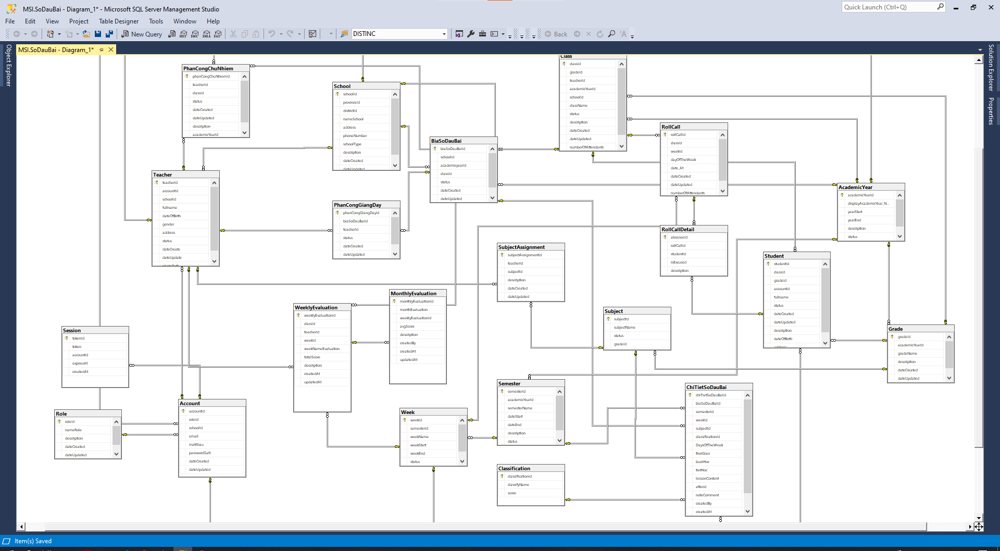
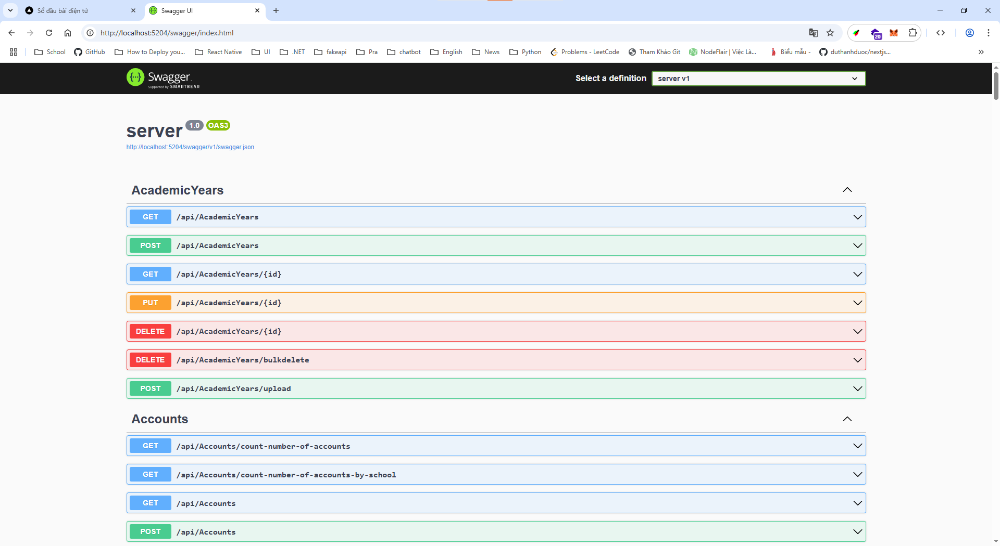
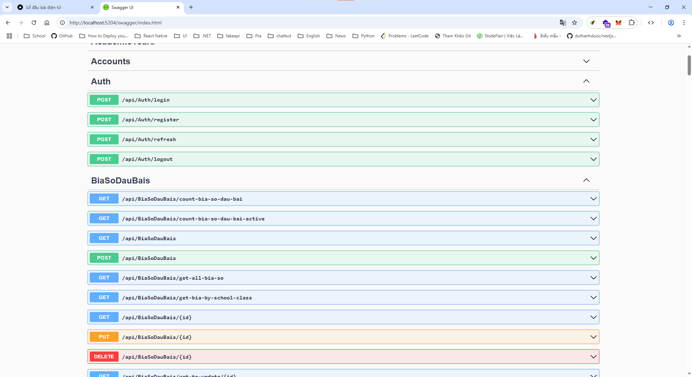
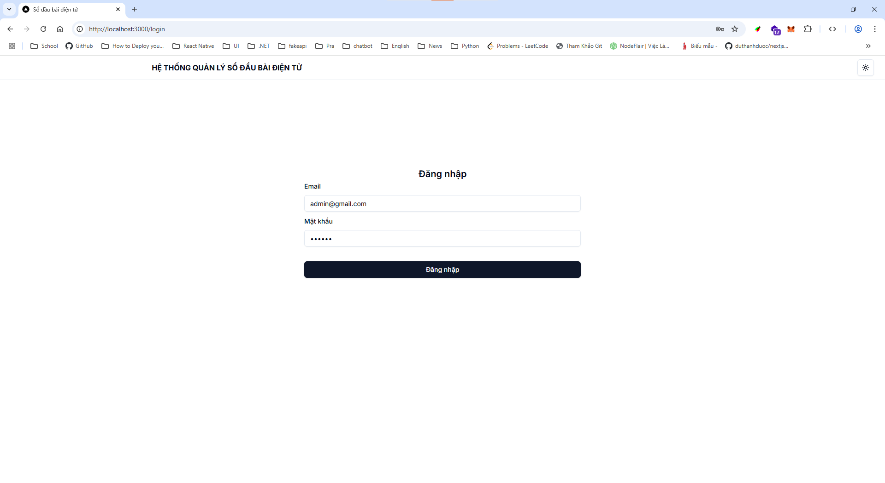
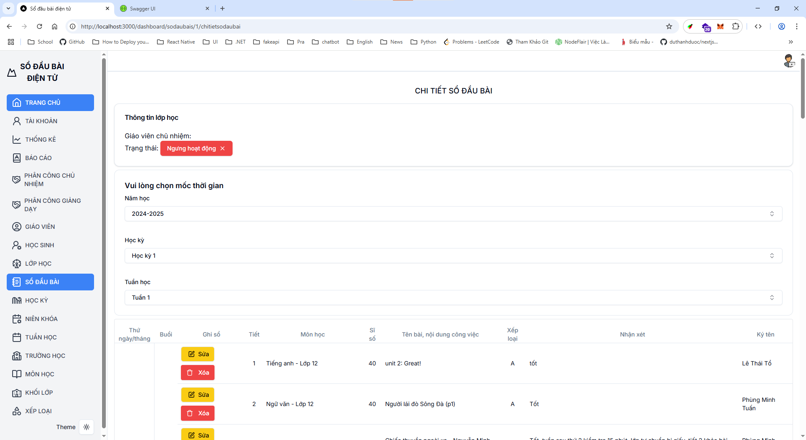
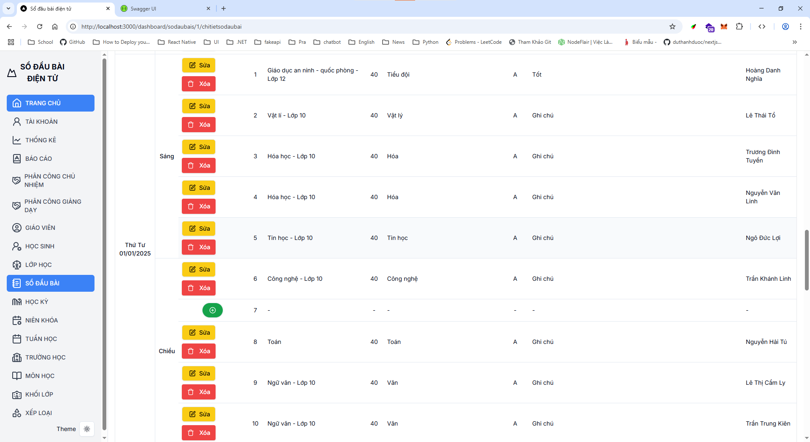
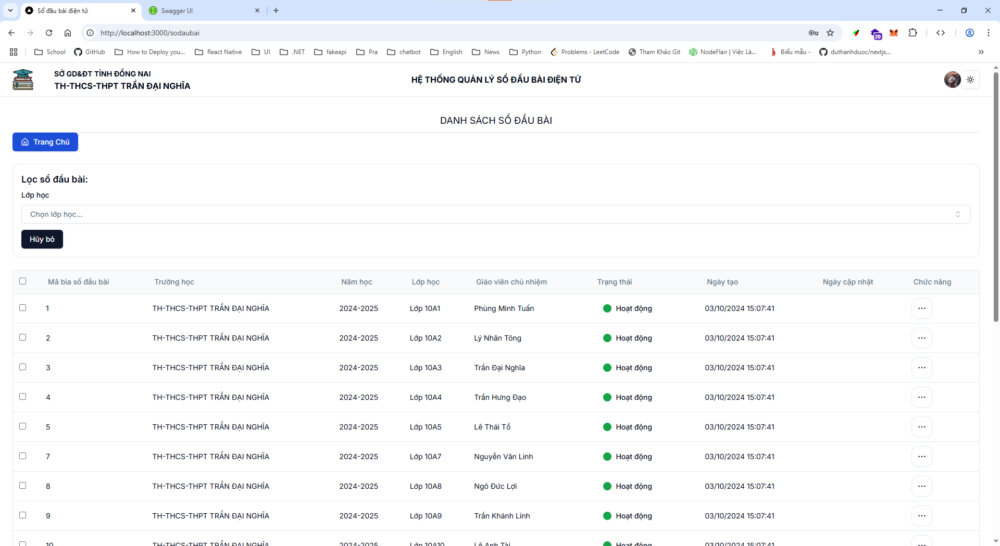
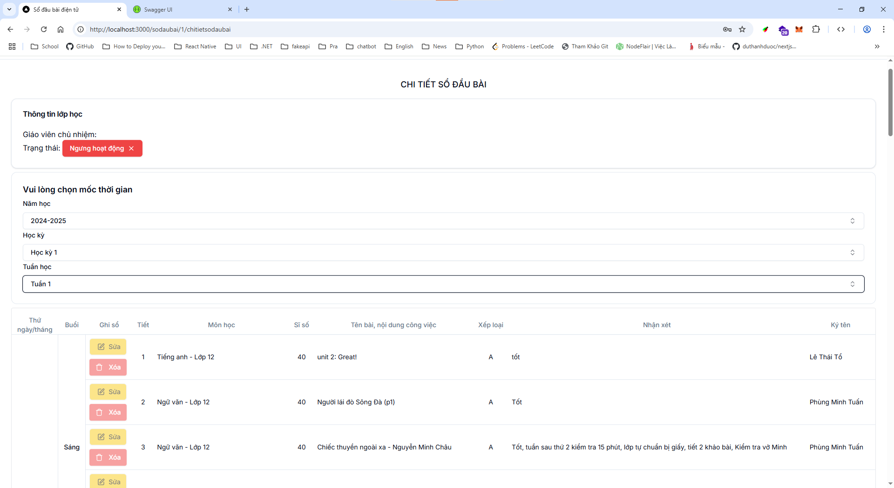
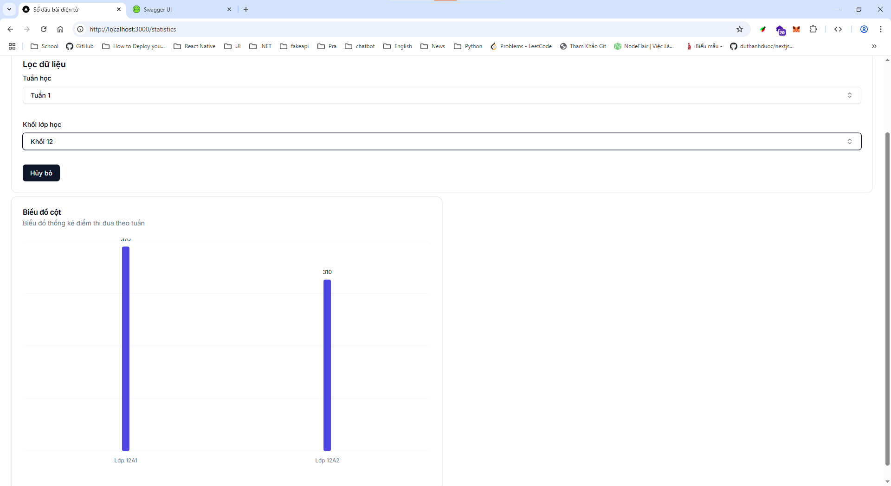

<p align="center">
  <a href="./README.md"></a>
  <a href="./README_en.md"></a>
</p>

# 📘 SỔ ĐẦU BÀI - Quản lý sổ đầu bài điện tử

> Website khắc phục những bất lợi so với việc sử dụng sổ đầu bài giấy như các tình trạng sổ bị lạc mất, bị ướt, lớp trưởng quên lấy sổ, đặc biệt website hỗ trợ giáo viên ghi sổ và chỉnh sửa ngay lập tức (trong thời gian nhất định) với thiết bị điện tử có Internet.

## 🧠 Mục đích

- Giúp nhà trường quản lý sổ đầu bài thông qua Website.
- Hiệu trưởng có thể theo dõi tình trạng giảng dạy, đánh giá nhanh các tiết học của tất cả các lớp.
- Giáo viên sử dụng các thiết bị điện tử như điện thoại, tablet, laptop để tạo mới và chỉnh sửa thông tin tiết học mà không cần di chuyển đến lớp.
- Ghi nhận chủ đề bài học, đánh giá tiến trình theo ngày, tuần giúp giáo viên và nhà trường nắm bắt hiệu quả giảng dạy.

## 🖥️ Giao diện người dùng

Frontend được phát triển với **Next.js** và sử dụng thư viện giao diện hiện đại **Shadcn UI**, mang lại trải nghiệm mượt mà, nhanh chóng và tối ưu trên nhiều thiết bị.

## 🔧 Công nghệ sử dụng

### Front-end

- **Next.js 14+** (React, App Router, TypeScript)
- **Shadcn UI** & **Tailwind CSS**

### Back-end

- **.NET 8.0 (C# 12)** / **ASP.NET Core Web API**
- **Entity Framework Core 8.0** & **Dapper**
- **Microsoft SQL Server** (hỗ trợ cơ chế failover connection string)
- **ASP.NET Core API Versioning** (`Asp.Versioning.Mvc` - chuẩn `api/v1/[controller]`)
- **JWT Authentication** & **Role-Based Access Control (RBAC)** với permission filters
- **AutoMapper 13.x**
- **CloudinaryDotNet** (quản lý và lưu trữ hình ảnh)
- **ClosedXML & ExcelDataReader** (xử lý import/export file Excel)
- **log4net & Microsoft.Extensions.Logging**

---

## 🏛️ Kiến trúc phần mềm (Software Architecture)

Hệ thống Backend được thiết kế và tái cấu trúc theo mô hình **Layered (N-Tier) Architecture** gồm 4 tầng phân tách độc lập, áp dụng nguyên lý Dependency Inversion và luồng phụ thuộc một chiều nghiêm ngặt:

```text
server/
├── server.sln                                          # Solution kết nối toàn bộ dự án
└── src/
    ├── SoDauBai.Domain/                                # 1. Domain Layer (Entity Models thuần túy, 0 phụ thuộc bên ngoài)
    │   ├── Common/ (IBaseEntity.cs)                    # Chuẩn entity chung (Id, Deleted, DateCreated, DateUpdated)
    │   └── Entities/ (27 Domain Entities)              # Student, Week, Class, Teacher, ChiTietSoDauBai,...
    │
    ├── SoDauBai.Application/                           # 2. Application Layer (Nghiệp vụ, DTOs & Contracts)
    │   ├── Common/ (Exceptions, ApiResponseModel, PaginatedResponse)
    │   ├── DTOs/ (Các đối tượng DTOs, Types/ response wrappers)
    │   ├── DTOs/Search/ (16 Search DTOs kế thừa QueryObject)
    │   ├── Interfaces/ (Contracts cho Repositories và Services)
    │   └── Mappings/ (AppAutomapper Profile)
    │
    ├── SoDauBai.Infrastructure/                        # 3. Infrastructure Layer (Truy xuất dữ liệu & Tích hợp)
    │   ├── Data/ (SoDauBaiContext - EF Core DbContext)
    │   ├── Repositories/ (BaseRepository<TEntity> & các Repositories cụ thể)
    │   ├── Services/ (SessionUser, FileUploadService, LoggerManager, TokenService,...)
    │   ├── Helpers/ (ExcelHelper, ValidatorHelper)
    │   └── DependencyInjection.cs                      # AddInfrastructureServices(Configuration)
    │
    └── SoDauBai.Api/                                   # 4. Presentation Layer (ASP.NET Core Web API Host)
        ├── Controllers/ (BaseApiController.cs)         # Controller cơ sở chuẩn hóa Success/Error envelope
        ├── Controllers/v1/                             # Toàn bộ 26 API Controllers có versioning
        ├── Filters/ (AuthorizationFilter, CustomAuthorize, RequirePermission)
        ├── Middlewares/ (ApiLoggingMiddleware, JWTHeaderMiddleware)
        ├── Transformers/ (SlugifyParameterTransformer)
        ├── Program.cs                                  # Composition Root tinh gọn
        └── appsettings.json / log4net.config
```

### Các mẫu thiết kế & cải tiến kiến trúc cốt lõi:

1. **Generic Repository Pattern (`BaseRepository<TEntity>`):**
   - Chuẩn hóa toàn bộ CRUD, phân trang offset/cursor, bulk delete và cơ chế soft-delete tự động (`Deleted = true`).
2. **Base API Controller & Standard Response Envelope (`ApiResponseModel`):**
   - Mọi endpoint trả về định dạng đồng nhất qua `Success(data)` / `Error(ex)`.
3. **Phân quyền và bảo mật nâng cao:**
   - Bộ lọc `[CustomAuthorize]` kết hợp `[RequirePermission("CREATE")]`, `[RequirePermission("UPDATE")]`, `[RequirePermission("DELETE")]`.
4. **Dependency Injection Encapsulation:**
   - Đóng gói toàn bộ cấu hình DbContext, failover, repositories và adapters thông qua extension method `services.AddInfrastructureServices(Configuration)`.

---

## 🚀 Tính năng nổi bật

- 📆 Ghi chép, chỉnh sửa tiết học theo tuần/ngày.
- 👨‍🏫 Giáo viên thao tác dễ dàng trên điện thoại.
- 🏫 Hiệu trưởng và nhà trường theo dõi tiến độ giảng dạy toàn trường.
- 🔒 Bảo mật, phân quyền người dùng theo vai trò: giáo viên, quản trị, hiệu trưởng.
- 📊 Thống kê tổng quan tiết học theo tuần/lớp.
- 📥 Xuất và nhập dữ liệu sổ đầu bài, phân công giảng dạy qua Excel.

## 📸 Demo giao diện

_Back-end_


_Test API Back-end_



_Front-end_
_Hình ảnh Login_


_Hình ảnh ADMIN layout..._

> Chi tiết sổ đầu bài
>  > 

_Hình ảnh Teacher layout..._

> Chi tiết sổ đầu bài
>  > 

> Thống kê điểm tuần học theo tuần
> 

---

## 📂 Cài đặt & triển khai

### 1. Back-end (.NET 8)

```bash
# Di chuyển vào thư mục dự án
cd server

# Khôi phục dependencies và build toàn bộ solution (4 projects)
dotnet restore server.sln
dotnet build server.sln

# Khởi chạy Web API host
dotnet run --project src/SoDauBai.Api/SoDauBai.Api.csproj

# Hoặc khởi chạy với chế độ watch (hot reload)
dotnet watch --project src/SoDauBai.Api/SoDauBai.Api.csproj
```

- **Swagger UI:** `http://localhost:5000/swagger`
- **OpenAPI Schema:** `http://localhost:5000/swagger/v1/swagger.json`

### 2. Front-end (Next.js)

```bash
# Di chuyển vào thư mục client
cd client-next

# Cài đặt dependencies
npm install # hoặc yarn install

# Khởi chạy môi trường phát triển
npm run dev # hoặc yarn dev
```

- **Client URL:** `http://localhost:3000`

### 3. Testing with Cypress

```bash
cd client-next
yarn run cypress:open
```

---

## 💡 Đóng góp

Chúng tôi luôn chào đón các ý kiến đóng góp và pull request từ cộng đồng để phát triển dự án tốt hơn!
